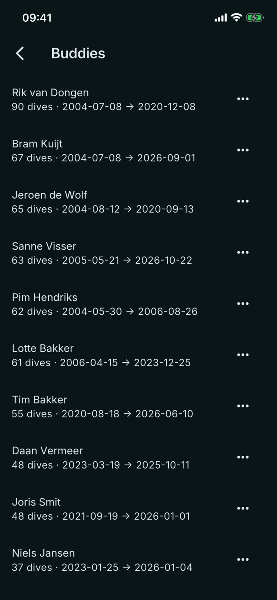

# Buddies

Where: **Dives** tab, people button in the top bar.

## What it's for

Everyone you have entered as a buddy, with how often and over what period you dived together. It is also where you tidy up names.

## On this screen

- **Name**: the buddy as you typed it on a dive. Buddies exist only because you add them to dives; the dive computer logs no names.
- **Dive count and date range**: for example "63 dives" followed by the first and last date. The count updates as you add or remove the buddy on dives.
- **Three-dot menu**: **Rename** and **Delete**.
- **Rename buddy**: a dialog with a **Name** field. If the new name already exists, the two are merged and the app says "Merged into" the name.
- **Remove buddy**: removes the name from all of that buddy's dives. The dives themselves stay.

## Good to know

- With no buddies yet, the screen reads "Add buddies to your dives and they'll show up here."
- Add a buddy to a dive on the **Details** tab, in the **Buddies** field below the chart. Names you have used before are offered as you type.
- Renaming is the way to fix a spelling or to combine two spellings of one person.
