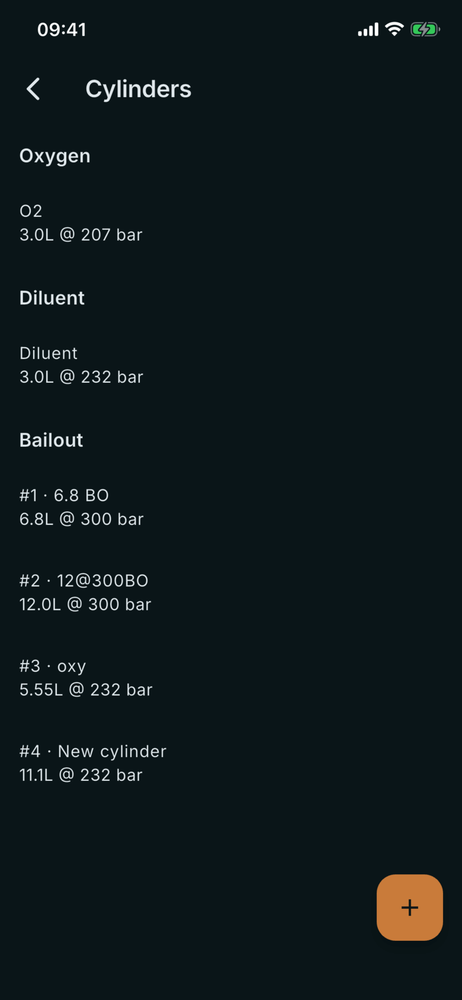
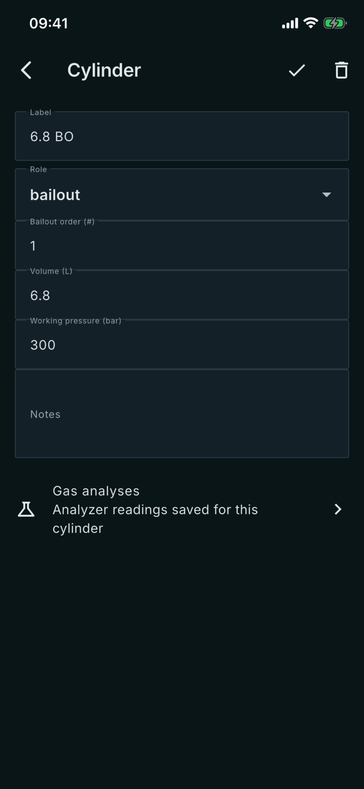

# Cylinders

Where: **Equipment** tab, **Cylinders** card. Tap a cylinder to open it.

## What it's for

Your cylinders, entered by you. They are what you link to dives and what the gas analyzer saves its readings against.

## On this screen

- **Groups**: **Oxygen**, **Diluent**, **Bailout** and **Offboard**, shown only when they have a cylinder.
- **Row**: the label, then the volume and working pressure, for example 3L @ 200 bar. Bailout rows start with their order, like **#1**.
- **Set up standard CCR cylinders**: shown on an empty list; creates an oxygen, a diluent and a bailout cylinder to edit.
- **Label**: your name for the cylinder.
- **Role**: oxygen, diluent, bailout or offboard.
- **Bailout order (#)**: the order of a bailout cylinder in your list. It is only used for the Bailout role.
- **Volume (L)** and **Working pressure (bar)**: the figures you type for the cylinder.
- **Notes**: free text.
- **Gas analyses**: opens the analyzer readings saved for this cylinder; see [Analyse](/manual/gas-analyse).

## Good to know

- Everything here comes from you; nothing is read from the dive computer.
- Volume is entered in litres and working pressure in bar.
