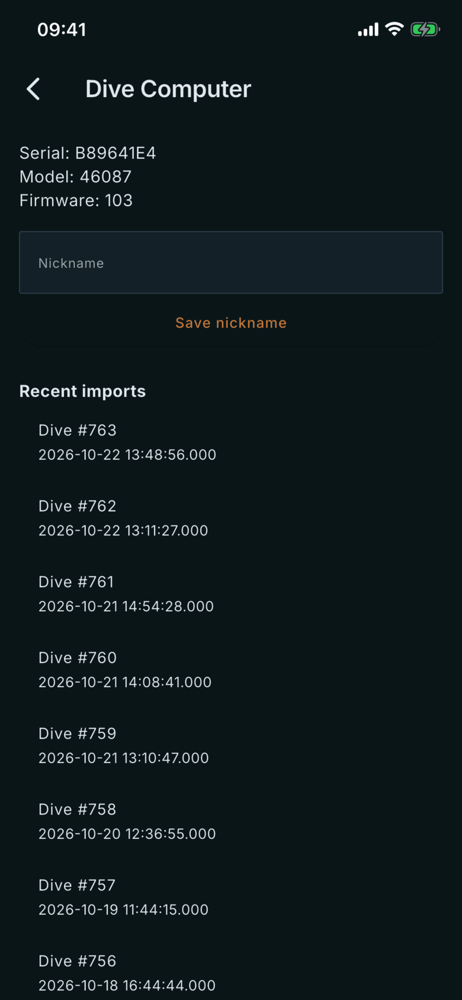

# Dive Computers

Where: **Equipment** tab, **Dive Computers** card. Tap a computer to open it.

## What it's for

Every dive computer you have imported from appears here by itself, Shearwater or another brand. The screen shows what the computer reported about itself, and lets you give it a nickname to tell two units apart.

## On this screen

- **List row**: the model (for example Petrel 3) with the end of the serial number, then **FW** with the firmware version and how long ago the entry was last updated. The model, serial and firmware come from the dive computer, not from the name it showed in the scan. For other brands the row shows **Unknown** as the model for now; a nickname replaces it.
- **Serial**, **Model**, **Firmware**: as the computer reported them at import. You cannot edit them. Model shows the computer's raw model code, not the name in the list; for other brands it is **0**. Serial is shown in hexadecimal.
- **Nickname**: your own name for the unit. Type it and tap **Save nickname**. The list then shows the nickname.
- **Recent imports**: the latest dives imported from this computer, as **Dive #** (the computer's own dive number) with the date and time. The app does not read other brands' dive numbers yet, so their dives show as **Dive #0**.
- **Pressure mapping**: **Add channel** adds the next channel number (0 to 3). Pick one of your cylinders for it, or leave it **unmapped**. A mapped channel's tank pressure line on the dive profile then carries that cylinder's label.

## Good to know

- The list names a computer from its stored hardware ID. If the app does not know that ID, the list shows **Unknown** for the model.
- For another brand's computer, each dive's **Information** tab names the brand and model the computer reported, for example **Divesoft Liberty**, and shows the serial in decimal. See [Dive information](/manual/dive-information).
- You do not add computers here. Import a dive (see [Import](/manual/import)) and the computer appears. For another brand, the computer tells the app its model and serial during the download, and the entry is added then.
- The nickname and the pressure mapping are the only things you change here.
