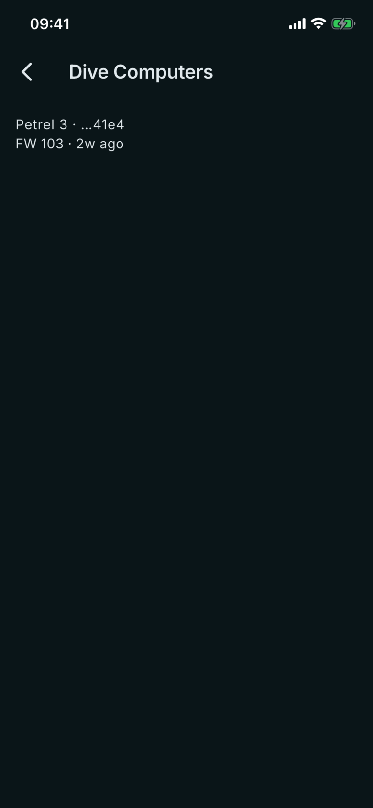
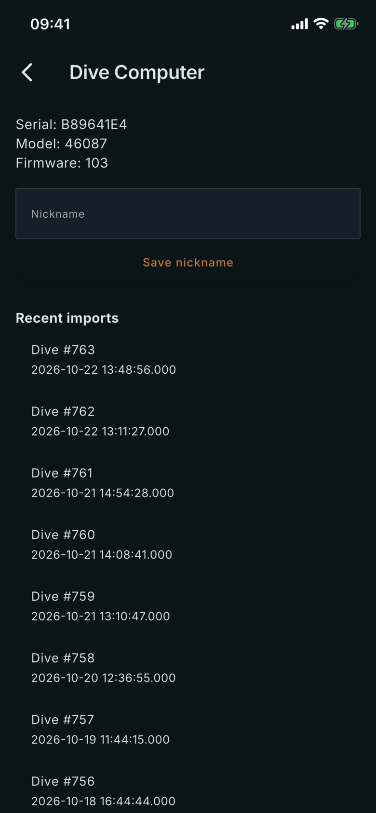

# Dive Computers

Where: **Equipment** tab, **Dive Computers** card. Tap a computer to open it.

## What it's for

Every Shearwater you have imported from appears here by itself. The screen shows what the computer reported about itself, and lets you give it a nickname to tell two units apart.

## On this screen

- **List row**: the model (for example Petrel 3) with the end of the serial number, then **FW** with the firmware version and how long ago the entry was last updated. The model, serial and firmware come from the dive computer.
- **Serial**, **Model**, **Firmware**: as the computer reported them at import. You cannot edit them.
- **Nickname**: your own name for the unit. Type it and tap **Save nickname**. The list then shows the nickname.
- **Recent imports**: the latest dives imported from this computer, as **Dive #** (the computer's own dive number) with the date and time.
- **Pressure mapping**: lists which pressure channels are mapped, with **Add channel** to add one by hand.

## Good to know

- You do not add computers here. Import a dive (see [Import](/manual/import)) and the computer appears.
- The nickname is the only field you can change.
