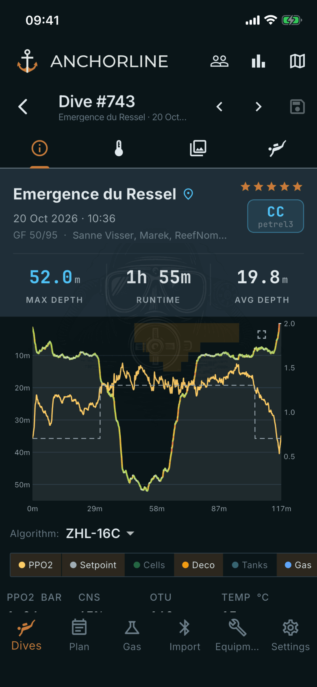
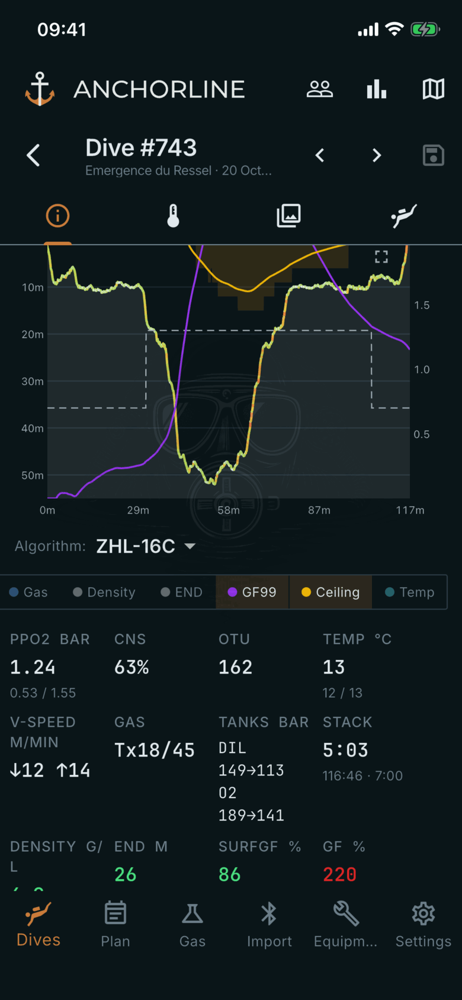

# Dive details

Where: **Dives**, tap a dive, **Details** tab.

## What it's for

The post-dive view of one dive: the profile and the numbers behind it. Swipe or use the arrows beside the title to move between dives; the tab row switches between Details, Information, Media and Equipment.

## On this screen

- **Header**: site, date, buddies, your star rating and the mode badge with the computer model. **MAX DEPTH**, **RUNTIME** and **AVG DEPTH** are below.
- **Profile**: depth against time. The crosshair, when you touch the chart, reads out the values at that moment. The expand button opens the chart full screen.
- **Algorithm**: switches the displayed deco calculation between ZHL-16C and VPM-B.
- **Trace buttons**: **PPO2**, **Setpoint**, **Cells**, **Deco**, **Tanks**, **Gas**, **Density**, **END**, **GF99**, **Ceiling** and **Temp** show or hide each overlay. Samples come from the computer; GF99, ceiling, density and END are calculated by the app.
- **Readout tiles**: **PPO2**, **CNS**, **OTU**, **Temp**, **V-speed**, **Gas**, **Tanks**, **Stack**, **Density**, **END**, **SurfGF**, **GF**, **Deco** and **TTS**. Tiles turn green, orange or red for density, END and the GF values.
- **Below the tiles**: **Cell data**, **Tissue saturation**, then the editable **Divemaster**, **Buddies**, **Tags** and **Notes**.

## Good to know

- Tiles that do not apply, such as PPO2 or Deco on an open-circuit dive, are hidden or shown as a dash.
- The **Save** button in the top bar saves your edits; the app asks before you leave with unsaved changes.
