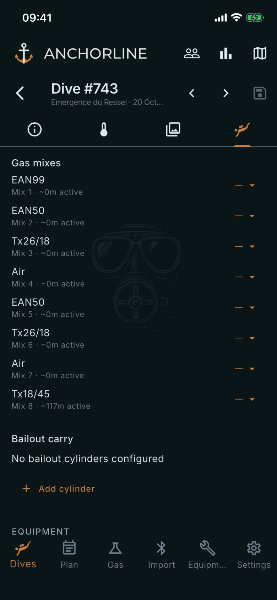
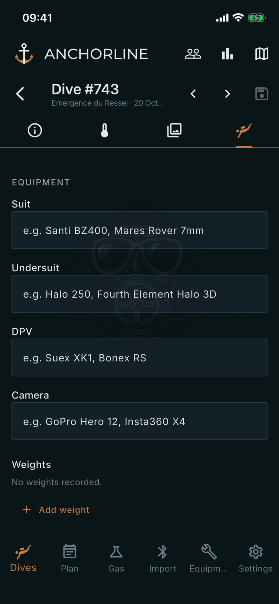

# Dive equipment

Where: **Dives**, tap a dive, **Equipment** tab.

## What it's for

What you carried and wore on this dive. The gas mixes come from the computer; everything you link or type is yours.

## On this screen

- **Gas mixes**: one row per mix the computer logged, for example EAN50 or Tx18/45, with its position number and how long it was active. The drop-down at the right links the mix to one of your cylinders. A dash means none is linked.
- **Bailout carry**: the bailout cylinders you carried. **Add cylinder** picks from your cylinders and lets you set the gas mix and fill pressure. Each row has **Remove**.
- **Suit**, **Undersuit**, **DPV**, **Camera**: free text. Earlier entries are offered as suggestions as you type.
- **Weights**: **Add weight** records each weight you carried.

## Good to know

- With no cylinders defined, add them first under the **Equipment** tab, **Cylinders**.
- Active time for a mix is approximate, taken from the gas in use at each sample.
- Cells and the scrubber are not linked here. The cells the computer logged appear in **Cell data** on the Details tab, and scrubber time on the Information tab.
