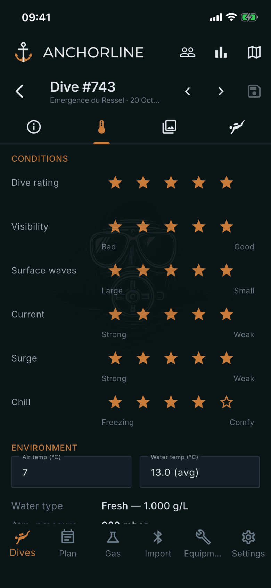
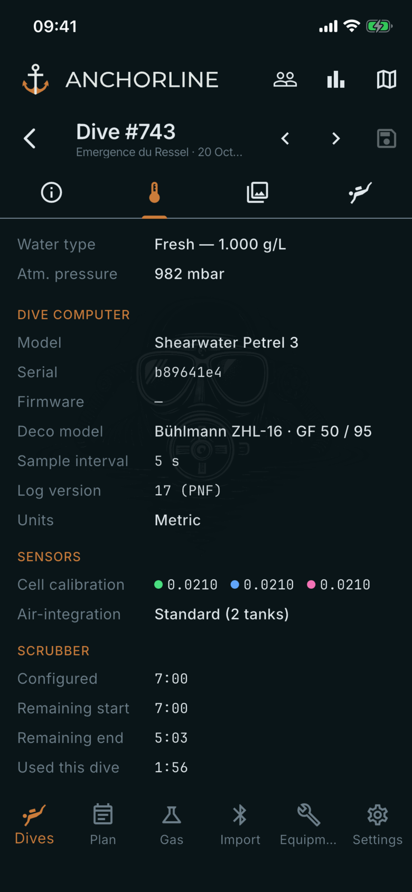

# Dive information

Where: **Dives**, tap a dive, **Information** tab.

## What it's for

Your conditions notes for the dive, plus a record of what the dive computer logged. The first part is yours to edit; the second is read-only.

## On this screen

- **Dive rating**: your star rating, also shown in the dive header.
- **Visibility**, **Surface waves**, **Current**, **Surge**, **Chill**: five-star scales you set yourself. The words under the stars show which end is which, for example Bad to Good.
- **Air temp (°C)** and **Water temp (°C)**: you can type a value. Water temp suggests the average logged by the computer.
- **Water type** and **Atm. pressure**: logged by the computer.
- **Dive computer**: **Model**, **Serial**, **Firmware**, **Deco model** with its GF, **Sample interval**, **Log version** and **Units**, all as logged.
- **Sensors**: **Cell calibration** per cell and **Air-integration**, for example Standard (2 tanks).
- **Scrubber**: **Configured** time, **Remaining start**, **Remaining end** and **Used this dive**, as logged by the computer.

## Good to know

- Notes, buddies, tags and the divemaster are on the **Details** tab, below the chart.
- A dash means the computer did not log that value.
- Changes are kept when you press **Save** in the top bar.
