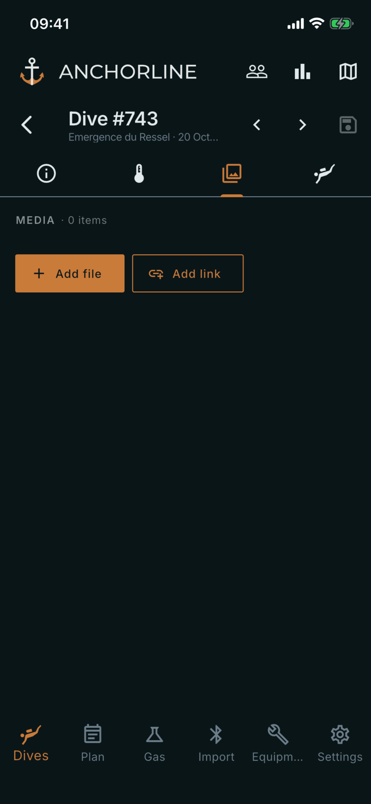

# Dive media

Where: **Dives**, tap a dive, **Media** tab.

## What it's for

Photos, PDFs and links that belong to one dive: a site map, a photo, a video link. They belong to you and sync with your other signed-in devices.

## On this screen

- **MEDIA**: the heading, with the number of items attached.
- **Add file**: pick one or more files from your camera, photo library or files.
- **Add link**: opens a sheet with a **URL** field. Enter an address and tap **Add link**.
- **Item tile**: its three-dot menu offers **Open**, **Edit** and **Delete**. Delete shows **UNDO** afterwards.
- **Image viewer**: tap a photo to view it. The top bar has **Info**, **Share** and **Delete**; Info shows filename, type, size, upload time and description.
- **PDF viewer**: opens PDFs the same way, with the same three buttons.
- **Retry**: appears on a tile if an upload failed.

## Good to know

- Links open in your browser. Other files open in the app that handles them on your device.
- The file size limit is 25 MB per file.
- The Media tab shows only what you attached; the dive computer logs no media.
