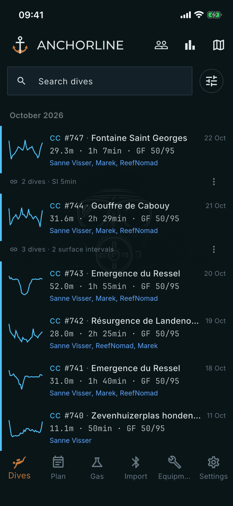

# Dives

Where: **Dives** tab in the bottom bar.

## What it's for

The list of every dive you have imported, newest first and grouped by month. Tap a row to open the dive.

## On this screen

- **Search dives**: filters the list as you type. The **x** clears the search.
- **Filters** (the sliders button): opens a sheet with **Dive mode**, **Site**, **Buddy** and **Tag**. Active filters show as chips above the list. **Apply** sets them, **Clear all** removes them.
- **Row**: dive mode (for example CC), dive number, site, date, maximum depth, runtime and GF low/high. The line below lists buddies. The mode, depth, runtime and GF come from the dive computer; site and buddies come from you.
- **Sparkline**: a small depth profile at the left of each row.
- **Merged group**: a row with a chain icon and, for example, "2 dives · SI 5min" or "3 dives · 2 surface intervals". Several segments of one outing are shown as one dive, with the deepest depth and total time in the water. Tap its three-dot menu and choose **Unmerge** to split it again.

## Good to know

- Long-press a row to select dives. The top bar then offers **Select all**, **Renumber selected dives** and **Merge selected dives**.
- Swipe a row left and confirm **Delete dive?** to hide it. A snackbar offers **UNDO** for six seconds.
- The stored dives are always single segments. Merging only changes how they are shown.
