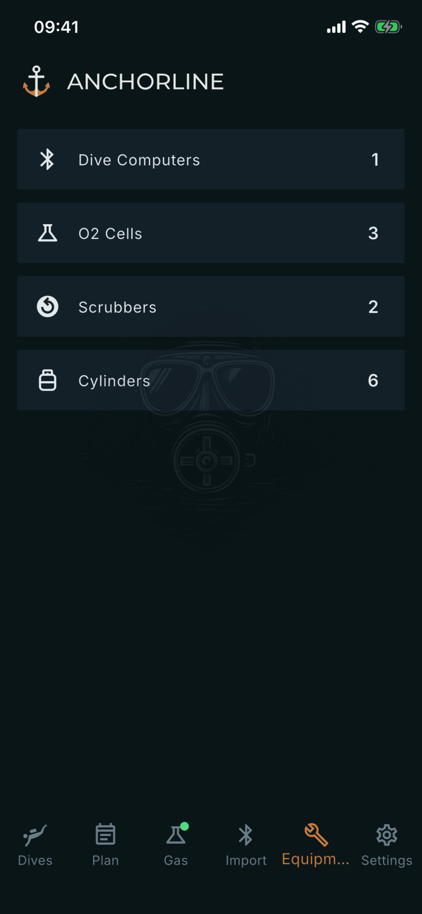

# Equipment

Where: **Equipment** tab in the bottom bar.

## What it's for

The starting point for the gear Anchorline keeps track of. Each card opens a list, and each list opens the detail of one item. Pull down to refresh the counts.

## On this screen

- **Dive Computers**: the dive computers you have imported from, with the number on the right. They are added when you import; see [Dive Computers](/manual/dive-computers).
- **O2 Cells**: the cells you have set up, by slot. See [O2 Cells](/manual/o2-cells).
- **Scrubbers**: your scrubber packs and how long each has been used. See [Scrubber Sessions](/manual/scrubbers).
- **Cylinders**: oxygen, diluent and bailout cylinders. See [Cylinders](/manual/cylinders).

## Good to know

- The counts are numbers of entries, not of dives.
- Everything you enter here syncs with your account like the rest of your logbook. The cell and scrubber figures are worked out from your dives.
