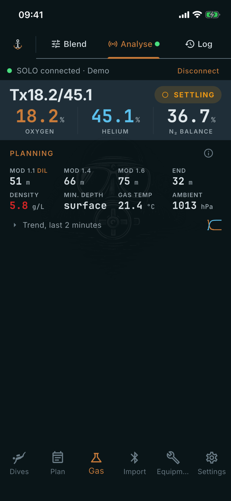

# Analyse

Where: **Gas** tab, **Analyse** sub-tab.

## What it's for

Shows a live reading from a Divesoft SOLO gas analyzer, works out planning values and saves the result to your gas log.

## On this screen

- **Connection strip** (top): shows **Not connected**, **Connecting…** or **SOLO connected**. Pick a source, then tap **Connect** (**Disconnect** when connected). The sources are **USB** on macOS, Windows and Linux, **USB (Android)** on Android, and **Demo**. **Demo** is a simulated analyzer for trying the screen without hardware. On iOS, Demo is the only source.
- **Readout**: **OXYGEN**, **HELIUM** and **N₂ BALANCE**, with a pill that reads **NO DATA**, **SETTLING**, **STABLE** or **SENSOR ERROR**. The analyzer measures oxygen and helium. The app computes the nitrogen balance.
- **PLANNING**: **MOD** at 1.1 (diluent), 1.4 and 1.6, then **END**, **Density**, **Min. depth**, **Gas temp** and **Ambient**. Gas temperature and ambient come from the analyzer. The rest is computed by the app.
- **Trend, last 2 minutes**: tap to open a chart of the recent readings.
- **Save analysis**: appears only with a real analyzer connected, not in Demo mode. Choose the role (**Diluent**, **Bailout**, **Backgas** or **Deco**), the desired mix, a **Cylinder**, **Fill pressure**, **Analysed by** (initials), **For** and **Notes**. You enter these.
- **Closes …** line: appears in the form while you have open blends (see [Blend](/manual/gas-blend)). It says which blend the save closes, for example **Closes Tx18/45 · blended 1 h 05 min ago**, or **Closes no blend**. The app picks the oldest open blend whose mix matches your reading. **Change** lets you choose **Automatic**, one of the open blends, or **None**. If no blend matches, the line reads **No open blend matches. Nearest: Tx50 (red)**. A closed blend gives the analysis its mix as the desired mix and its role.
- **Warning line**: when the reading is off its mix, the app shows a warning. For **Bailout**, **Backgas** and **Deco**, more oxygen than planned gets a bold red line with the MOD, such as "O2 52.0% instead of 50%: MOD at 1.6 is 21 m, not 22 m." Everything else shows a short grey note naming the analysed mix and the target. Nothing blocks the save. The warning is computed by the app.
- **Residual** (switch, next to **+ Add a note**): marks the save as a residual analysis, of the gas left in a cylinder before you blend. A residual closes no blend, has no desired mix and prints no label. After you save it, the **In the cylinder now** mix and pressure on the Blend tab are filled from it (the pressure only if you entered a fill pressure).
- **Save** stores the reading. **Log on OK** saves each time you press OK on the SOLO. **Save & print** also prints a label.

## Good to know

- **Save & print** and **Print a label on each OK** appear after you set up a label printer (**Set up label printer**).
- A save that closes an open blend says so in its message, for example "closes Tx18/45".
- Room air is not logged on OK. Tap **Save** for it.
- An OK press before the reading is stable is saved and marked in the log.
