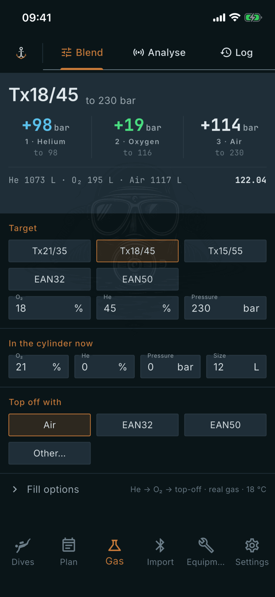

# Blend

Where: **Gas** tab, **Blend** sub-tab.

## What it's for

Works out how to fill a cylinder to a target mix. You enter the target and what is in the cylinder now, and the app computes the fill steps, the litres of each gas and a cost.

## On this screen

- **Plan band** (top): the target and pressure, then one step per gas, for example **+98 bar** helium to 98, **+19 bar** oxygen to 116 and **+114 bar** air to 230. Below the steps are the litres per gas and a total cost. Tap the cost for the breakdown. All of it is computed by the app.
- **Target**: tap a preset (Tx21/35, Tx18/45, Tx15/55, EAN32, EAN50), or type your own **O₂**, **He** and **Pressure**.
- **In the cylinder now**: **O₂**, **He**, **Pressure** and **Size** of what is already inside. You enter these.
- **Top off with**: the gas used for the last step: **Air**, **EAN32**, **EAN50** or **Other…**.
- **Fill options**: collapsed to a summary such as "He → O₂ → top-off · real gas · 18 °C". Open it to change the **Fill order**, switch **Real-gas maths (Z)** on or off, and set **Fill temp** and **Settled temp**.

## Good to know

- If the cylinder already matches the target the plan says so. If the blend cannot be made, the plan shows the reason instead of steps.
- The plan may also tell you to drain to a pressure first, or that a hot fill settles to a lower pressure.
- Pressure is in bar, volume in litres, temperature in degrees Celsius.
