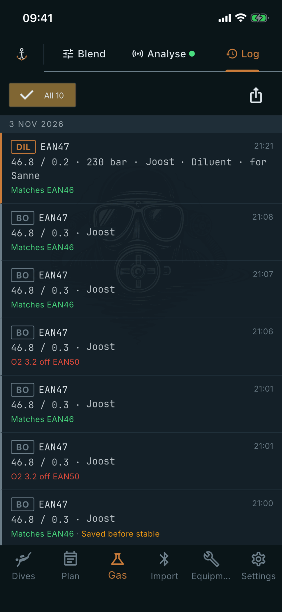

# Log

Where: **Gas** tab, **Log** sub-tab.

## What it's for

Keeps every analysis you saved from the Analyse tab, newest first, so you can see what went into each cylinder and whether it matched the desired mix you chose when saving.

## On this screen

- **All 10**: the filter chip, with the number of entries. A **Needs sign-off** chip appears when some entries do.
- **Day headers**: entries are grouped by day (**Today**, **Yesterday**, then the date).
- **Role chip**: **DIL** for diluent, **BO** for bailout / deco. Next to it is the mix name, such as **EAN47**, and the time.
- **Measured values**: oxygen and helium percentages as the analyzer measured them (for example 46.8 / 0.2), then the fill pressure, who analysed it, the cylinder, and who it was **for**. You entered the pressure, initials, cylinder and **For** when you saved.
- **Match line**: the app compares the reading to the desired mix you chose when saving: **Matches EAN46** in green, or a warning such as **O2 3.2 off EAN50** in red. **Saved before stable** marks a reading taken before it settled.
- **Export CSV** (the share icon): writes the entries shown (after any filter) to a CSV file and opens the share sheet.
- **Print label**: on each entry once you set up a label printer. It is unavailable until the entry is signed off.

## Good to know

- Tap an entry to edit it or sign it off. Swipe it left to delete it.
- A cylinder's page under Equipment has a **Gas analyses** entry showing only its analyses.
