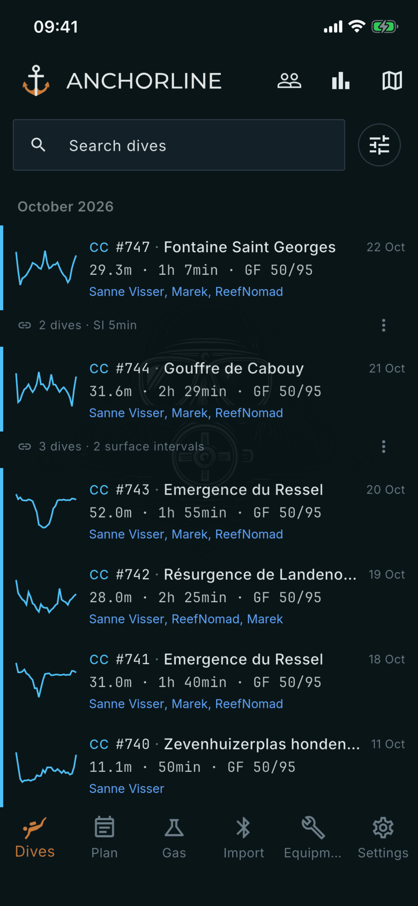

# Getting started

Where: Opens when you start the app.

## What it's for

Anchorline logs dives from your Shearwater computer and shows them in a way that puts closed-circuit data first. This page names the parts of the screen you see on launch.

## On this screen

- **Top bar**: the Anchorline name, which takes you back to the dive list from anywhere, and three buttons: **Buddies**, **Statistics** and **Dive sites map**.
- **Bottom bar**: six tabs. **Dives** is your logbook, **Plan** the planner, **Gas** the blending and analysing tools, **Import** downloads dives from your computer, **Equipment** holds your computers, cells, scrubbers and cylinders, and **Settings** holds the options.
- **Search dives** and the filter button: narrow the list. See [Dives](dives.md).
- **Dive rows**: each row is one logged dive, newest first.

## Good to know

- With no dives yet, the list reads "No dives yet". Open the **Import** tab to pair your Shearwater and download them.
- The dark theme is the default. Change it under **Settings**, **General**, **Theme**.
- Dive data from your computer is never edited. Notes, buddies, ratings and equipment are yours and are layered on top.
