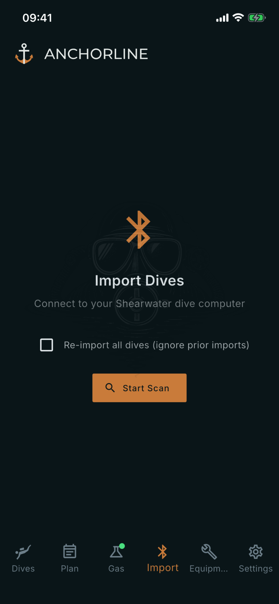

# Import Dives

Where: **Import** tab in the bottom bar.

## What it's for

Downloads dives from your Shearwater dive computer over Bluetooth. Dives you already have are skipped, so you can import after every trip.

## On this screen

- **Start Scan**: searches for nearby Shearwater computers. Put the computer in its Bluetooth upload mode first. Tap yours in the list; the app connects and shows its model, serial number and firmware.
- **Re-import all dives (ignore prior imports)**: normally the app remembers the last dive it imported from each computer and asks only for newer ones. With the box ticked it lists every dive on the computer.
- **Dive list**: new dives, all ticked, with dive number and start time. **All** and **None** change the selection; **Import all** or **Import N selected** starts the download. If nothing is new, the screen says "All dives already imported".
- **Progress**: a ring counts dives saved; a bar shows the dive now arriving. The marker moves only past dives that were saved.
- **Done**: "Imported N dives", plus how many failed. **View Dives** opens the Dives tab; **Import More** starts over.

## Good to know

- If "No devices found yet..." stays, check that the computer is in upload mode and close by, then scan again. After an error, **Retry** restarts; saved dives stay saved.
- With many dives, import in batches: Petrel log sessions can time out around 60 seconds.
- Recent imports per computer are on its page: see [Dive Computers](/manual/dive-computers). For an existing Subsurface logbook, use **Import from Subsurface** in Settings: see [Sync](/manual/settings-sync).
