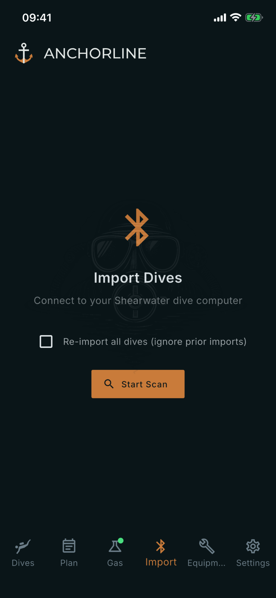

# Import Dives

Where: **Import** tab in the bottom bar.

## What it's for

Downloads dives from your dive computer over Bluetooth. A Shearwater goes through Anchorline's own reader. Other brands' Bluetooth computers, such as Ratio, OSTC and Divesoft, go through libdivecomputer, the open-source library that Subsurface also uses. Dives you already have are skipped, so you can import after every trip.

## On this screen

- **Start Scan**: searches for nearby dive computers for 15 seconds, with "Searching for dive computers...". Put the computer in its Bluetooth upload mode first.
- **Scan list**: a Shearwater shows its Bluetooth name (or **Shearwater DC**) with the device ID below. Another brand's computer shows the brand and model the app matched from its Bluetooth name, with that name below. If the name fits several models, the row shows the brand and the name instead (only the name when the models are from different brands), with **Model found when connected** below; the computer tells the app its model once connected. If the name fits more than one kind of computer, tapping the row asks **Which of these is your computer?** first.
- **Not yet tested by us**: a tag on every computer that is not a Shearwater. We have not yet checked any other brand against a download from a real computer. The download may well work; please tell us how it went (see **Record this download** and **Share this download** below).
- **Scan again**: when the 15 seconds are up, the screen reads **Scan finished**. Tap **Scan again** to search once more.
- **My computer isn't listed**: for a computer that is in upload mode but not in the list, because the app does not recognise its Bluetooth name. Pick the brand (**Which brand?**), then the model, then which Bluetooth device it is (**Which device is your …?**). The brands and models are every Bluetooth computer the app can read, except Shearwater and the computers that need a PIN in the download (see below). The device list follows the scan; if it reads "No named Bluetooth devices seen yet", put the computer in upload mode and scan again.
- **Re-import all dives (ignore prior imports)**: normally the app remembers the last dive it imported from each computer and asks only for newer ones. With the box ticked, a Shearwater lists every dive on the computer, and another brand's computer sends all of its dives. Dives you already have are not added twice.
- **Record this download**: a switch on the start and scan screens, "Other brands only. Keeps what the computer says so you can send it to us." With it on, the next download from another brand also keeps every Bluetooth packet, which is what we need to fix a download that went wrong. It stays on until you switch it off or restart the app. It does nothing for a Shearwater.
- **Dive list** (Shearwater): new dives, all ticked, with dive number and start time. **All** and **None** change the selection; **Import all** or **Import N selected** starts the download. If nothing is new, the screen says "All dives already imported".
- **Progress** (Shearwater): a ring counts dives saved; a bar shows the dive now arriving. The marker moves only past dives that were saved.
- **Download** (other brands): there is no list of dives first. Once connected, the app downloads every new dive straight away: "Downloading from …" with the brand and model, a progress bar and how many dives are saved. **Cancel** stops it; the dives already saved stay, and the screen reads "Download stopped (cancelled). N dives saved."
- **Done**: "Imported N dives", plus how many failed and which dives the computer would not send, for example "Skipped dive #1: the dive computer would not send it." **View Dives** opens the Dives tab; **Import More** starts over.
- **Share this download**: after a download from another brand, finished or stopped, this button writes the download to a text file and opens the share sheet. It does not appear when the connection itself failed. Send the file to recordings@anchorline.eu or attach it to an issue at github.com/Egbertdepauw/anchorline/issues. The file holds the dives on the computer, its serial number and any GPS positions it logged. Files over 10 MB are compressed. On Linux there is no share sheet: the file is saved to your Downloads folder, and a message shows where, with **Open folder**.

## Good to know

- If "No devices found yet..." stays, check that the computer is in upload mode and close by, then scan again. After an error, **Retry** restarts; saved dives stay saved.
- With many dives on a Shearwater, import in batches: Petrel log sessions can time out around 60 seconds.
- A Shearwater can refuse to send a dive. The app skips that dive, downloads the rest and names the skipped dives on the done screen (and on the error screen if the connection drops later). A later normal import does not ask for a skipped dive again when newer dives were saved; tick **Re-import all dives** to try it once more.
- Another brand's download can stop with a reason, for example "Download stopped (the computer stopped answering). N dives saved." The app then still asks the computer for the same new dives next time, and the ones already saved are not added twice. The same is true when a dive could not be read.
- **Pairing and PINs**: Anchorline has no PIN screen of its own. If a computer asks to pair, your phone or computer shows its own Bluetooth pairing prompt; type the code the dive computer shows. Do it within about 15 seconds, or the connection gives up and you tap **Retry**. On Windows the app pairs without a prompt and answers 0000 when asked for a PIN, so a computer that wants another PIN does not pair there yet. On Linux the app does not answer a pairing request; pair the computer in the system's Bluetooth settings first.
- The Aqualung i330R and Apeks DSX ask for a PIN inside the download itself. The app cannot take one yet, so they do not appear in the scan or in **My computer isn't listed** until it can.
- On Windows, Shearwater computers do not appear in the scan yet. Other brands do.
- The app reads Bluetooth LE computers only. A computer with classic Bluetooth only, such as the Ratio iX3M GPS models from before the iX3M 2021, does not appear in the scan or in **My computer isn't listed**.
- If you already imported your logbook from Subsurface Cloud, downloading the same dive from the computer does not add a second copy. The Subsurface copy is updated with the downloaded data and keeps its notes, buddies, cylinders and start time. In the list of dives to import, copies updated by an earlier download are not offered again. After a download that updated dives, **View Dives** returns the Dives tab to its list.
- When the app improves how it reads Shearwater logs, it re-reads your stored dives from their saved raw data in the background after launch. Your notes and cylinders are kept. On a large log the sync indicator may show "Syncing…" for a few minutes.
- After the first download, the computer appears under Equipment with the model and serial it reported: see [Dive Computers](/manual/dive-computers). For an existing Subsurface logbook, use **Import from Subsurface** in Settings: see [Sync](/manual/settings-sync).
