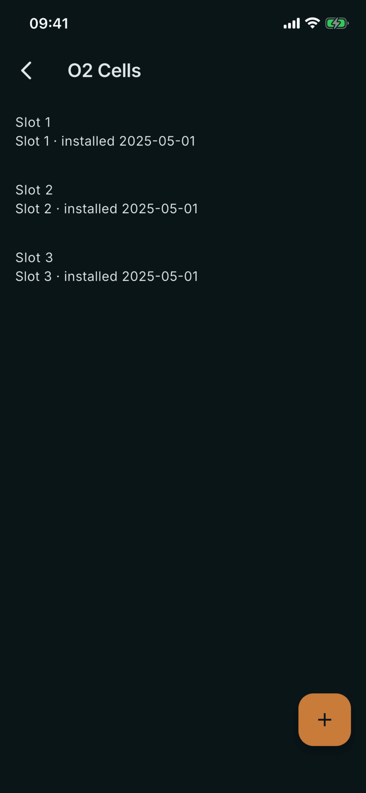
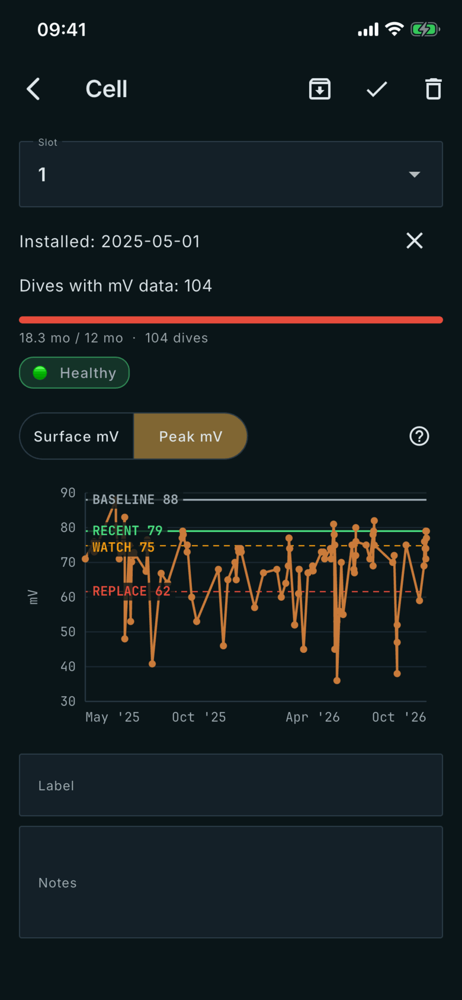

# O2 Cells

Where: **Equipment** tab, **O2 Cells** card. Tap a cell to open it, or tap **+** to add one.

## What it's for

Tracks each oxygen cell across the dives it was installed for, showing how its millivolt readings change. The chart and chip are the app's indication, not a safety check.

## On this screen

- **List row**: your label, or **Slot N** without one, with the install date. Retired cells carry a **Retired** chip.
- **Slot**: 1 to 4; mV readings exist for 1 to 3 only. Retire the old cell before reusing a slot.
- **Installed**: the date you fitted the cell. You set it.
- **Dives with mV data**: how many dives in the cell's window have readings for its slot. They come from the dive computer.
- **Age bar**: months since install against 12, and the dive count, with a chip: **Healthy**, **Watch**, **Replace** or **Insufficient data**.
- **Surface mV / Peak mV**: Surface is the average reading in the first metre of each dive. Peak is the highest reading of each dive.
- **Reference lines** (Peak only): **BASELINE** is the best peak of the first five dives. **RECENT** is the best peak of the last five. **WATCH** is 85% of baseline and **REPLACE** 70%. RECENT on or above WATCH is Healthy; on or above REPLACE is Watch; below is Replace.
- **Label**, **Notes**: yours. The icons retire, save and delete the cell; a cell with dives cannot be deleted.

## Good to know

- Lines and verdict need at least five dives.
