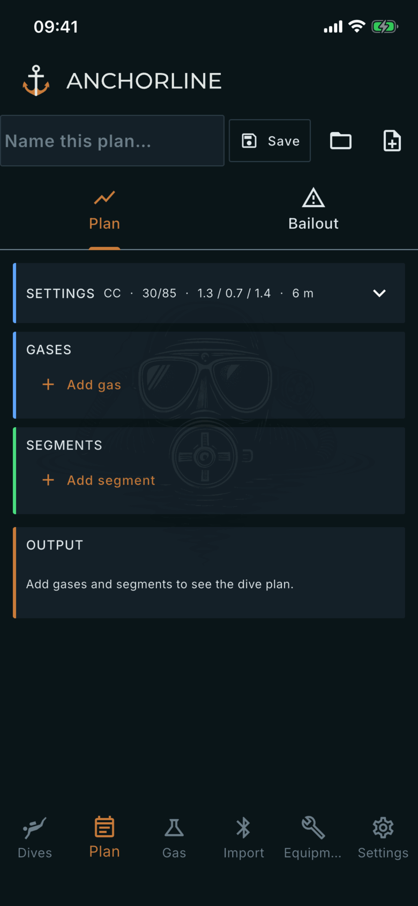
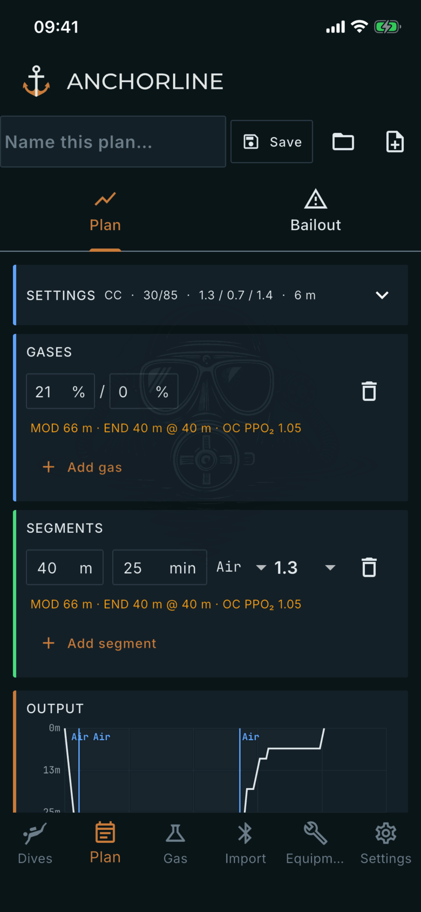
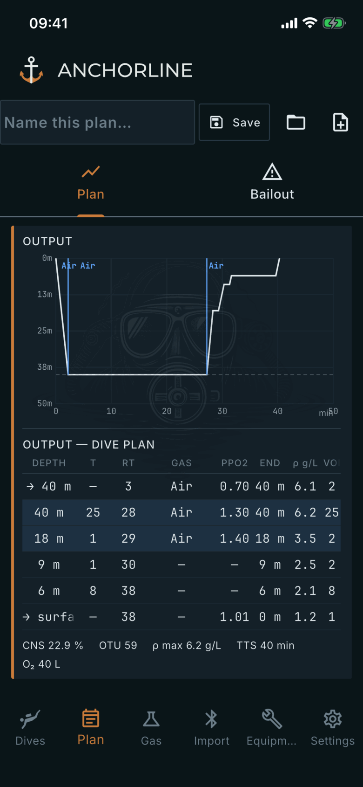

# Plan

Where: **Plan** tab in the bottom bar.

## What it's for

A gas and deco calculator: you describe gases and segments, the app computes the ascent and the numbers around it. It is a calculation tool, not diving advice.

## On this screen

- **Name this plan…**, **Save**, the folder button and the new-plan button: you name and save a plan, reopen a saved one, or start a blank one.
- **Plan** and **Bailout** tabs: the plan itself, and its bailout.
- **SETTINGS**: you choose mode (**CC** or **OC**), algorithm (**ZHL-16C** or **VPM-B**), GF low and high, setpoints and last stop. 
- **GASES**: **Add gas** and enter the mix. The app computes each gas's MOD, END and PPO₂.
- **SEGMENTS**: **Add segment** and enter depth, time, gas and setpoint.
- **OUTPUT**: the app computes a depth chart and the dive plan table (**DEPTH**, **T**, **RT**, **GAS**, **PPO2**, **END**, density, volume), with the ascent stops, then the totals: **CNS**, **OTU**, **ρ max**, **TTS** and **O₂** used.
- **Bailout tab**: you add bailout bottles from the plan's gases under **BAILOUT BOTTLES**. The app computes the **BAILOUT PROFILE**, an ascent on those bottles from your deepest segment.

## Good to know

- Nothing is computed until the plan has a gas and a segment.
- Default settings come from Settings, Planning.
