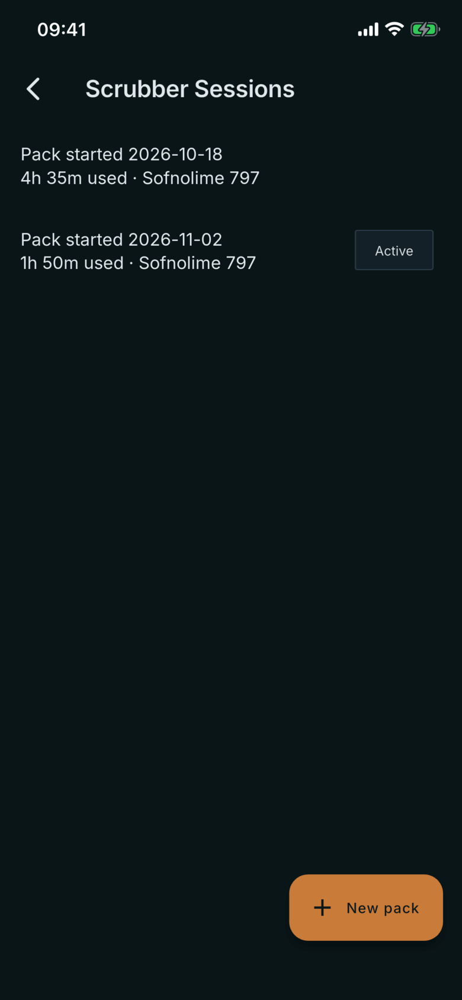
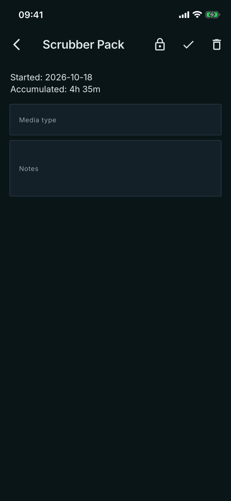

# Scrubber Sessions

Where: **Equipment** tab, **Scrubbers** card. Tap a pack to open it.

## What it's for

Keeps a record of each scrubber pack and how many hours of diving it has seen, so you do not have to add it up yourself. Only the app's tally is shown; it does not tell you when to change a pack.

## On this screen

- **List row**: **Pack started** with the date, then the time used and the media type. The open pack carries an **Active** chip. A closed pack has no chip and shows its final time.
- **New pack**: starts a pack today. Create one before the dives you want counted, because time counts from its start date.
- **Started**: the date the pack began.
- **Accumulated**: the total runtime of your dives since the start date, added up from the dive computer's logs. For an open pack it counts until the next pack starts. Merged dives are counted by their segments.
- **Media type**: for example the scrubber material. You type it, and **Notes** is yours too.
- **Icons**: the lock closes the pack, the check saves media type and notes, the bin deletes the pack.

## Good to know

- Closing a pack fixes its time at that moment, and the **Active** chip goes. The lock is then gone.
- Dives are counted by their start time, so a pack takes dives from its start date onward.
