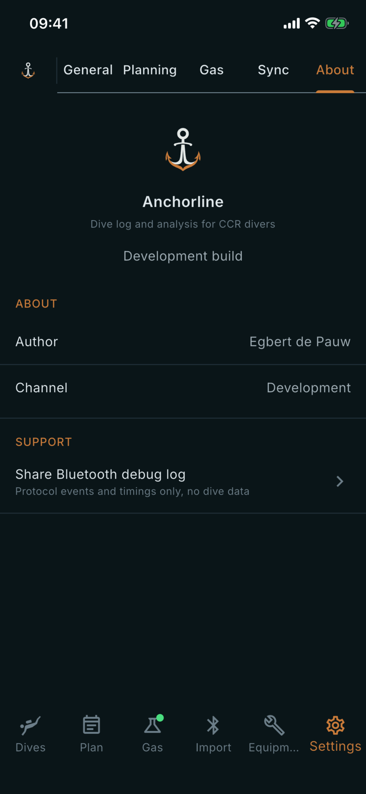

# About

Where: **Settings** tab, **About** sub-tab.

## What it's for

Which version of the app you are running, who makes it, and a way to send a Bluetooth log when an import goes wrong.

## On this screen

- **Anchorline**: the mark, the name and the line "Dive log and analysis for CCR divers".
- **Build line**: a release build shows **Version**, **Build** and, when known, **Date**. A development build, like the one in the screenshot, reads "Development build". Include the version and build number in any problem report.
- **Author**: who wrote the app.
- **Channel**: the release channel this build came from.
- **Share Bluetooth debug log**: opens the share sheet with the Bluetooth log, saved as a file. It holds protocol events and timings only, no dive data.

## Good to know

- If you have not imported yet there is no log; run an import first, then try again.
