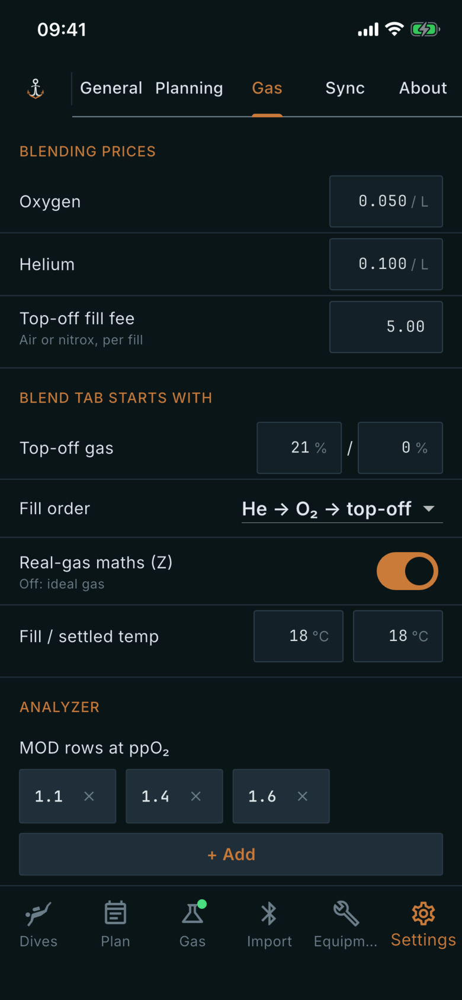

# Gas

Where: **Settings** tab, **Gas** sub-tab.

## What it's for

Defaults for blending and analysing gas: what your fills cost, what a new blend starts with, and which limits the analyzer shows. They save you retyping the same values.

## On this screen

- **Blending prices**: **Oxygen** and **Helium** are a price per litre. **Top-off fill fee** is a price per fill of air or nitrox. They are used for the cost of a blend.
- **Blend tab starts with**: the values a new blend opens with.
  - **Top-off gas**: the oxygen and helium percentages of your top-off gas.
  - **Fill order**: the order of steps, one of **He → O₂ → top-off**, **O₂ → He → top-off** or **O₂ → top-off → He**.
  - **Real-gas maths (Z)**: when on, blends use real-gas behaviour. When off, they use the ideal gas law.
  - **Fill / settled temp**: the temperature while filling, then once the cylinder has settled, in °C.
- **Analyzer**: **MOD rows at ppO₂** lists the ppO₂ values for which the analyzer shows a maximum operating depth. Remove one with its cross (the last one stays), or tap **+ Add** and enter a ppO₂ in bar. **Fill pressure starts at** sets the pressure a new analysis begins with, in bar.

## Good to know

- Where label printing is available, a **Label printer** section appears below the analyzer settings.
- The prices carry no currency; they are just numbers you choose.
