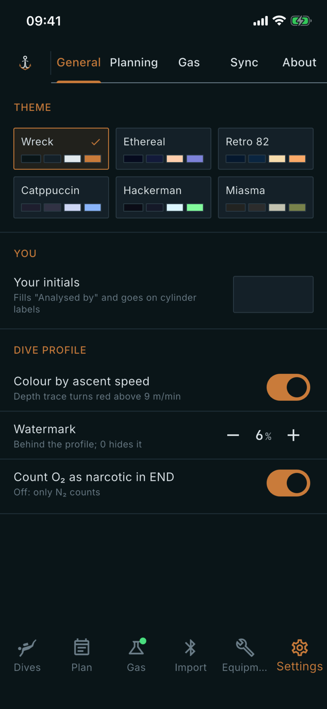

# General

Where: **Settings** tab, **General** sub-tab.

## What it's for

How the app looks, who you are on printed and exported records, and a few options for how the dive profile is drawn and worked out.

## On this screen

- **Theme**: pick the colour scheme: **Wreck**, **Ethereal**, **Retro 82**, **Catppuccin**, **Hackerman** or **Miasma**. The tick marks the one in use, and the change applies at once.
- **Your initials**: fills "Analysed by" on gas analyses and goes on cylinder labels. It is your own text and is empty until you type.
- **Colour by ascent speed**: when on, the depth trace on the profile turns red where you ascend faster than 9 m/min.
- **Watermark**: the strength of the faint mark behind the profile, as a percentage. Step it with the minus and plus buttons; 0 hides it.
- **Count O₂ as narcotic in END**: when on, oxygen counts towards the equivalent narcotic depth (END) shown for a dive. When off, only nitrogen counts.

## Good to know

- Settings are saved as you change them; there is no save button.
