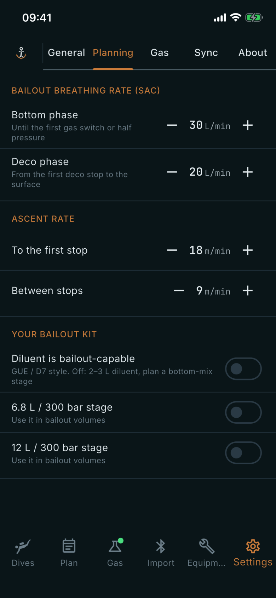

# Planning

Where: **Settings** tab, **Planning** sub-tab.

## What it's for

The numbers and equipment the bailout calculations on the [Plan](/manual/plan) tab start from. They are your own inputs; the app uses them as given.

## On this screen

- **Bailout breathing rate (SAC)**: your gas use in litres per minute, set with the minus and plus buttons.
  - **Bottom phase**: used until the first gas switch or half pressure.
  - **Deco phase**: used from the first deco stop to the surface.
- **Ascent rate**: in metres per minute.
  - **To the first stop**: the speed of the ascent up to the first stop.
  - **Between stops**: the speed from one stop to the next.
- **Your bailout kit**: what you carry, so bailout volumes are worked out with it.
  - **Diluent is bailout-capable**: tells the app your diluent cylinder can be breathed as bailout (GUE / D7 style). When off, the app assumes a 2-3 L diluent and plans a bottom-mix stage.
  - **6.8 L / 300 bar stage** and **12 L / 300 bar stage**: switch on each stage you have, to use it in bailout volumes.

## Good to know

- The kit switches start off.
