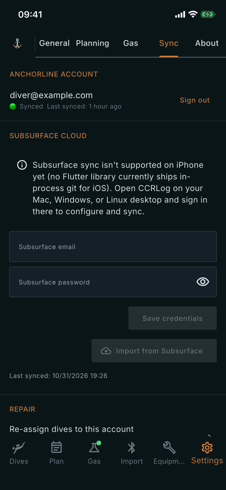

# Sync

Where: **Settings** tab, **Sync** sub-tab.

## What it's for

Signing in to keep your logbook the same on every device, connecting to Subsurface Cloud, and repair tools for when sync misbehaves.

## On this screen

- **Anchorline account**: signed out, you see **Sign in to enable cloud sync**. It is optional and the app works fully offline. Tap it to **Sign in** or **Create account** with an e-mail and password. Signed in, the row shows your address, the sync state (Synced, Syncing… or Offline), the time of the last sync and **Sign out**. Your local dives stay after you sign out.
- **Subsurface Cloud**: on Android and the desktops, enter **Subsurface email** and **Subsurface password** and tap **Save credentials**. **Import from Subsurface** adds the dives the app does not have yet; **Sync now** and **Push to Subsurface** send your dives there. **Last synced** shows when. On iPhone and iPad you see a notice that Subsurface sync is not supported there yet and to use a desktop.
- **Repair**:
  - **Re-assign dives to this account**: for dives imported while signed out or under another account.
  - **Push stuck uploads**: for when "Syncing…" never finishes; sends the queued changes one at a time.
  - **Reset local data**: wipes this device. The cloud copy stays and syncs back. You then quit and reopen the app. When you are signed in, the confirmation offers **Also delete cloud data**, which is permanent.

## Good to know

- Sign in before you import dives, so they upload under your account.
- After Reset local data, dives return from the cloud only if you were signed in and synced before.
