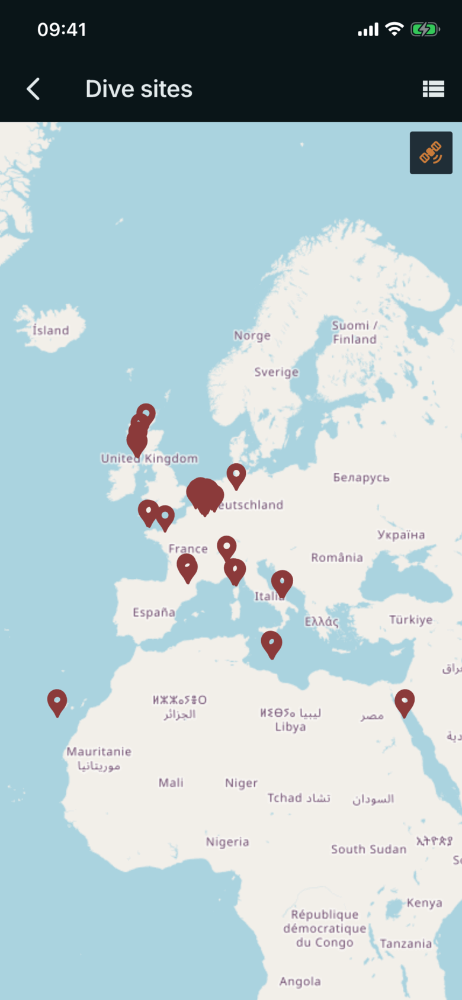

# Dive sites map

Where: **Dives** tab, map button in the top bar.

## What it's for

Every site you have placed on a dive, on one map. It is also the way to see where you have dived and which sites have a location at all.

## On this screen

- **Markers**: one per site that has coordinates. Tap one to open a card with the site name (or "Unnamed site"), its coordinates and, for named sites, how many dives you have there and the first and last date.
- **Layer button** (top right of the map): switches between the normal map and satellite imagery.
- **List view** (top right of the bar): swaps the map for a list of sites. Each site has a three-dot menu with **Rename** and **Delete**.
- **Back arrow**: returns to the dive list.

## Good to know

- Site names and coordinates are yours. Set them on the **Details** tab of a dive: type a **Site name**, then enter **Latitude** and **Longitude**, tap **Use current location**, or tap **Pick on map**.
- Renaming a site to a name that already exists merges the two. The app says so with "Merged into" and the name.
- Removing a site takes it off your dives but does not delete the dives.
