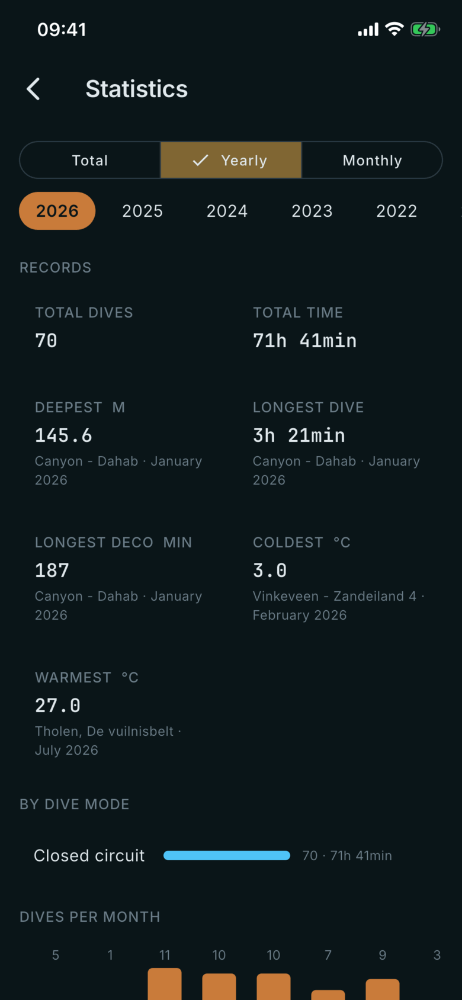

# Statistics

Where: **Dives** tab, bar chart button in the top bar.

## What it's for

Totals and records over your whole logbook, one year or one month. All figures are worked out from the dives you have imported.

## On this screen

- **Total / Yearly / Monthly**: choose the period. Yearly and Monthly add a row of years (and months) to pick from.
- **Records**: **Total dives** and **Total time**, then **Deepest**, **Longest dive**, **Longest deco**, **Coldest** and **Warmest**. Each record names the site and month where it happened. Depth, time and temperature come from the dive computer; site names come from you.
- **By dive mode**: a bar for each mode (for example Closed circuit) with its dive count and time.
- **Dives per month**: a bar chart for the chosen year. On the Total period you see **Dives per year** instead.

## Good to know

- Each record names the site and month, so it is only as detailed as the site names you entered.
- Depth is shown in metres and temperature in degrees Celsius.
